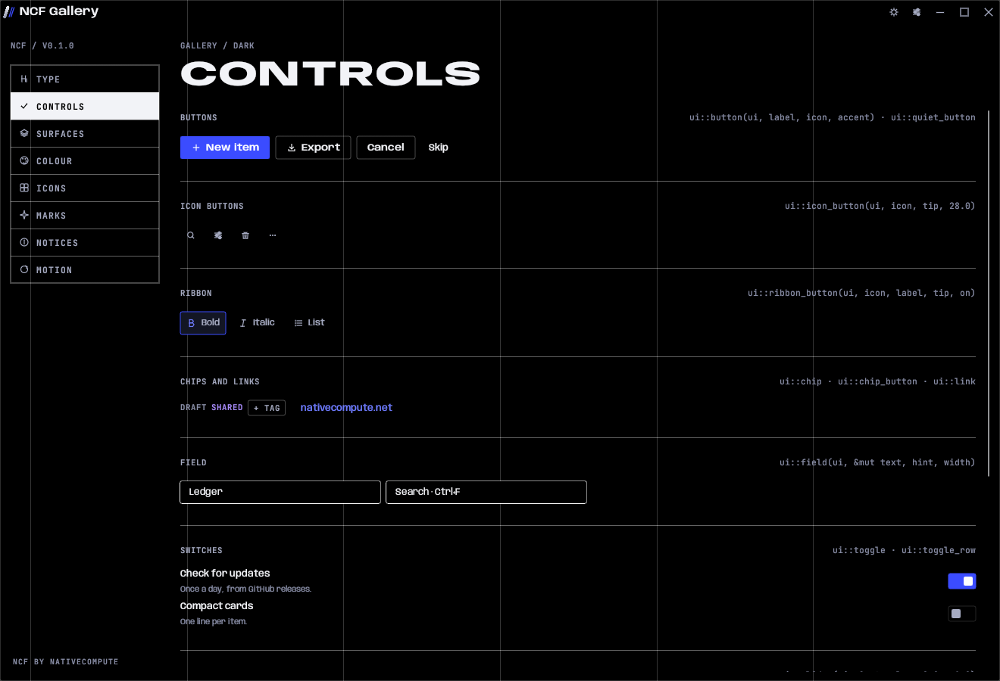

# NCF

**The NativeCompute Framework.** The look, the motion and the plumbing of every NativeCompute app and site, in one place.



- **Desktop:** a Rust crate on [egui](https://github.com/emilk/egui) for Linux and Windows apps. It gives you the theme, every component, the window frame, the splash, notices, settings, keyboard shortcuts, app icons and an update check.
- **Web:** `ncf.css` and `ncf.js`, with no build step, using the same tokens and class names as nativecompute.net.
- **One source of truth:** every colour, size and duration lives in [`tokens/ncf.toml`](tokens/ncf.toml) and is generated into Rust and CSS.
- **A new app in one command:** `ncf new Ledger` writes an app that builds, tests and ships on day one.
- **Written for people and agents:** [`AGENTS.md`](AGENTS.md) and [`docs/`](docs) describe the rules precisely enough to rebuild the style without guessing.

## A desktop app

```sh
cargo install --git https://github.com/NativeCompute/ncf --tag v0.1.0 ncf-cli
ncf new Ledger --tagline "Money, plainly." --repo NativeCompute/ledger
cd ledger && cargo run
```

Or add NCF to an existing app:

```toml
[dependencies]
ncf = { git = "https://github.com/NativeCompute/ncf", tag = "v0.1.0" }
```

```rust
use ncf::prelude::*;

const MARK: AppMark = AppMark {
    name: "Ledger",
    parts: &[slab((0.27, 0.83), (0.49, 0.17)), line((0.585, 0.83), (0.805, 0.17))],
};

const INFO: AppInfo = AppInfo {
    name: "Ledger",
    id: "net.nativecompute.Ledger",
    version: env!("CARGO_PKG_VERSION"),
    tagline: "Money, plainly.",
    repo: "NativeCompute/ledger",
    mark: MARK,
};

struct Ledger;

impl NcfApp for Ledger {
    fn ui(&mut self, ui: &mut egui::Ui, shell: &mut Shell) {
        ui::eyebrow(ui, "Ledger / 0 entries");
        ui::giant(ui, "This month", 46.0);
        if ui::button(ui, "New entry", Some(Icon::Plus), true) {
            shell.ok("Entry added", "Find it at the top of the list.");
        }
    }
}

fn main() -> ncf::eframe::Result<()> {
    ncf::app::run(INFO, |_ctx, _shell| Ledger)
}
```

`ncf::app::run` opens the window with the app's icon, shows the splash, draws the title bar and column guides, and gives you Settings with Appearance and About, notices, confirmations, saved settings and the update check.

## A website

```html
<link rel="stylesheet" href="https://cdn.jsdelivr.net/gh/NativeCompute/ncf@v0.1.0/web/ncf.css">
<script src="https://cdn.jsdelivr.net/gh/NativeCompute/ncf@v0.1.0/web/ncf.js" defer></script>
```

Or copy `web/` (with `web/fonts`) into the site. Open [`web/gallery.html`](web/gallery.html) to see every component.

## What's inside

| Path | What |
|---|---|
| `tokens/ncf.toml` | Colours for both casts, type roles and sizes, spacing, shape, motion. |
| `crates/ncf` | The desktop framework. |
| `crates/ncf-tokens` | Generates `crates/ncf/src/tokens.rs` and `web/ncf-tokens.css`, and checks contrast. |
| `crates/ncf-cli` | `ncf new`, `ncf tokens`, `ncf mark`. |
| `crates/ncf-build` | A `build.rs` helper that embeds the Windows icon and version. |
| `templates/app` | What `ncf new` writes. |
| `examples/gallery` | Every desktop component, in both casts. `cargo run -p ncf-gallery`. |
| `web` | `ncf.css`, `ncf.js`, the web fonts and the web gallery. |
| `brand` | The NativeCompute mark and logos. |
| `docs` | Design language, components, motion, app anatomy, brand, writing, releasing, recipes. |

## Docs

- [Design language](docs/design-language.md)
- [Components](docs/components.md)
- [Motion](docs/motion.md)
- [App anatomy](docs/app-anatomy.md)
- [Recipes](docs/recipes.md)
- [Brand](docs/brand.md)
- [Writing](docs/writing.md)
- [Releasing](docs/releasing.md)
- [For agents](AGENTS.md)

## Building NCF

```sh
cargo test --workspace --all-features
cargo run -p ncf-gallery
cargo run -p ncf-tokens          # after editing tokens/ncf.toml
tools/shots.sh                   # refresh docs/shots
```

Rust 1.76 or newer. On Linux the desktop crate needs the usual egui libraries (`libxkbcommon`, `libwayland`, `libGL`).

## Licence

MIT, see [LICENSE](LICENSE). The bundled fonts are under the SIL Open Font License; their licences sit next to them.

Made by [NativeCompute](https://nativecompute.net).
