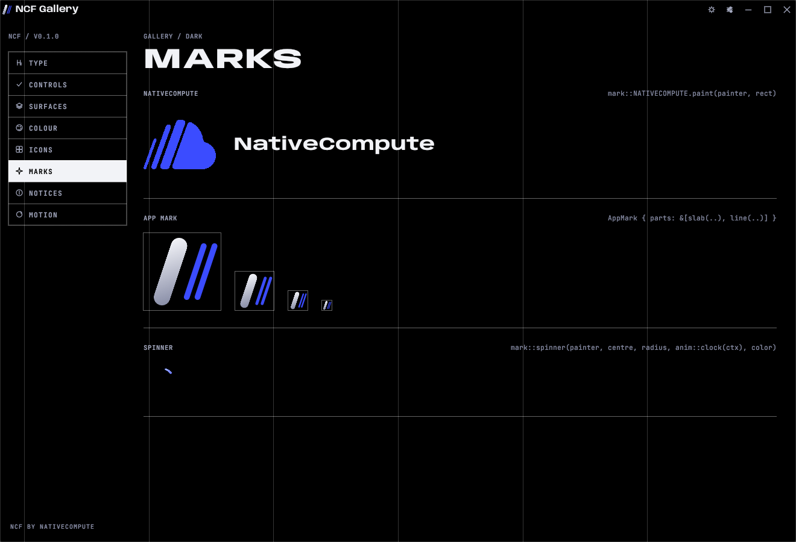

# Brand

## Name

**NativeCompute** is one word, with a capital N and a capital C. It is never "Native Compute", "Nativecompute" or "NC" in anything a person reads. The site is **nativecompute.net**, written in lower case without `https://` in running text.

The framework is **NCF**, the NativeCompute Framework.

## The NativeCompute mark

Four slanted signal-blue slabs that rise into a cloud. The source of truth is `brand/mark.svg`. The desktop crate carries the same shapes as polygon data in `crates/ncf/src/brand.rs` and paints them with `mark::NATIVECOMPUTE.paint(painter, rect)`.



| File | Use |
|---|---|
| `brand/mark.svg` | The mark alone. |
| `brand/logo-dark.svg` | Mark and wordmark, white text, for dark backgrounds. |
| `brand/logo.svg` | Mark and wordmark, dark text, for light backgrounds. |
| `brand/logo-white.svg` | All white, for photos and coloured backgrounds. |
| `brand/app-icon.svg` | The mark on a black rounded square, for a site's favicon and app tiles. |

On the web, show `logo-dark.svg` with `class="on-dark"` and `logo.svg` with `class="on-light"` side by side. `ncf.css` shows the right one for the cast.

Rules:
- Keep clear space around the mark of at least half its height.
- Never recolour, outline, rotate, stretch or add effects to the mark.
- The mark is always signal blue (#3B4CFF), or all white on a photo.

## App marks

Every NativeCompute app has its own mark in the same family: two or three slanted strokes, leaning right, on a black rounded square. One heavy **slab** in brushed chrome and one or two thin **lines** in signal blue.

```rust
pub const MARK: AppMark = AppMark {
    name: "Ledger",
    parts: &[
        slab((0.27, 0.83), (0.49, 0.17)),
        line((0.585, 0.83), (0.805, 0.17)),
    ],
};
```

- Coordinates are fractions of the square, from the top left. `(0.27, 0.83)` is the foot of the stroke, `(0.49, 0.17)` its head.
- `slab` is 0.21 of the square wide, in chrome. `line` is 0.075 wide, in signal.
- Keep the same lean for every stroke: about 0.22 across for every 0.66 up.
- Keep feet on 0.83 and heads on 0.17 so marks line up when shown together.
- For a shape that is not a stroke, use `Part::Polygon { points, ink }` with `Ink::Chrome`, `Ink::Signal` or `Ink::Text`. Concave shapes are fine.

What one mark gives you:

| Call | Gives |
|---|---|
| `MARK.paint(painter, rect)` | The mark in the UI, in the current cast. The title bar and splash already do this. |
| `MARK.svg()` | A 512 px SVG on the black tile. `your-app --emit-icon` writes it. |
| `MARK.ico()` | A Windows icon with 16, 24, 32, 48, 64 and 256 px images. `your-app --emit-ico` writes it; `build.rs` embeds it in the `.exe`. |
| `MARK.rgba(size)` | Raw pixels, supersampled. |
| `MARK.icon_data(128)` | The window icon. `ncf::app::run` sets it. |

`ncf mark --svg out.svg` and `ncf mark --ico out.ico` write the NativeCompute mark itself.

## Maker line

Every app says who made it, quietly, in HUD type at the foot of its main screen and in Settings → About: **LEDGER BY NATIVECOMPUTE**, linking to nativecompute.net. `ui::maker_line(ui, rect, centred, "Ledger")` draws it and returns true when clicked. Web pages use `<a class="maker" href="https://nativecompute.net">Built with NCF by NativeCompute</a>` in the footer.

The splash carries the same line: **BY NATIVECOMPUTE / NATIVECOMPUTE.NET**.

## Fonts

- **Anybody**, copyright The Anybody Project Authors (Etcetera Type Co), SIL Open Font License 1.1.
- **JetBrains Mono**, copyright The JetBrains Mono Project Authors, SIL Open Font License 1.1.

Both licences ship next to the files (`crates/ncf/fonts`, `web/fonts`). Keep them with any copy of the fonts.
