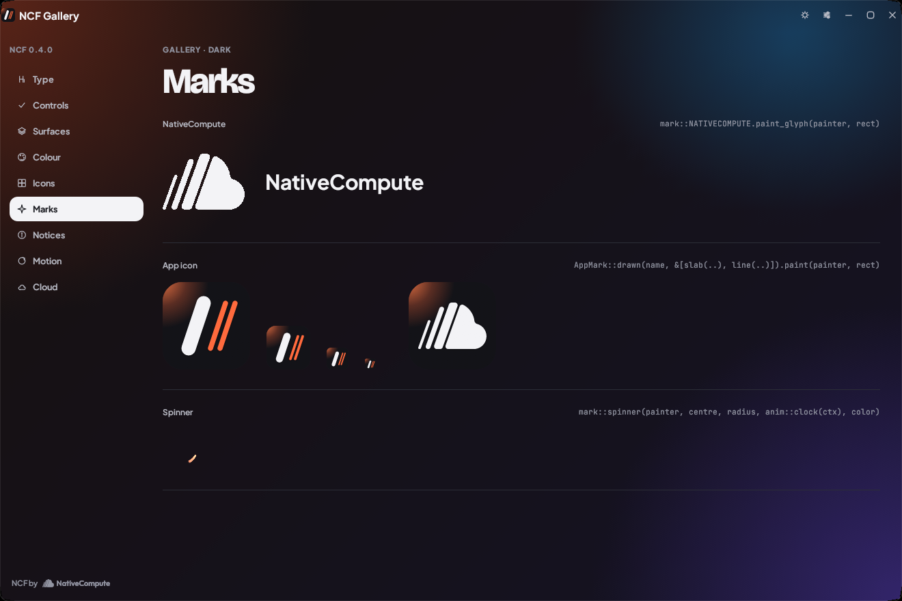

# Brand

## Name

**NativeCompute** is one word, with a capital N and a capital C. It is never "Native Compute", "Nativecompute" or "NC" in anything a person reads. The site is **nativecompute.net**, written in lower case without `https://` in running text.

The framework is **NCF**, the NativeCompute Framework.

## The NativeCompute mark

Four slanted slabs that rise into a cloud, in ink. The source of truth is `brand/mark.svg`. The desktop crate carries the same shapes as polygon data in `crates/ncf/src/brand.rs` and paints them with `mark::NATIVECOMPUTE.paint(painter, rect)`.



| File | Use |
|---|---|
| `brand/mark.svg` | The mark alone. |
| `brand/logo-dark.svg` | Mark and wordmark in near-white, for dark backgrounds. |
| `brand/logo.svg` | Mark and wordmark in ink, for light backgrounds. |
| `brand/logo-white.svg` | All white, for photos and coloured backgrounds. |
| `brand/app-icon.svg` | The mark on the Bento tile, for a site's favicon and app tiles. |

On the web, show `logo-dark.svg` with `class="on-dark"` and `logo.svg` with `class="on-light"` side by side. `ncf.css` shows the right one for the cast.

Rules:
- Keep clear space around the mark of at least half its height.
- Never recolour, outline, rotate, stretch or add effects to the mark.
- The mark is ink (#131318) on light, near-white (#F3F3F6) on dark, or all white on a photo.

## App icons

Every NativeCompute app icon sits on the same **Bento tile**: an ink square (#131318) with corners at 22.5% of its side and a coral glow from the top-left corner (`radial-gradient(75% 75% at 0 0, #FF7A46 at 85%, #FF6A3D at 30% by 36%, clear by 70%)`). The app's mark sits in the middle. `icon::BENTO_TILE` holds those numbers and `icon::compose` draws them, so every size comes out of the app binary the same way.

There are two kinds of mark.

**Drawn marks** are two or three slanted strokes, leaning right: one heavy **slab** in near-white and one or two thin **lines** in coral.

```rust
pub const MARK: AppMark = AppMark::drawn("Ledger", &[slab((0.27, 0.83), (0.49, 0.17)), line((0.585, 0.83), (0.805, 0.17))]);
```

**Picture marks** are a PNG with a transparent background, scaled to 79% of the tile's width with a soft drop shadow. NativeDraft's ribbon is one.

```rust
pub const MARK: AppMark = AppMark::raster("NativeDraft", include_bytes!("../assets/icon/mark.png"));
```

Drawn marks:

- Coordinates are fractions of the square, from the top left. `(0.27, 0.83)` is the foot of the stroke, `(0.49, 0.17)` its head.
- `slab` is 0.21 of the square wide, in chrome. `line` is 0.075 wide, in signal.
- Keep the same lean for every stroke: about 0.22 across for every 0.66 up.
- Keep feet on 0.83 and heads on 0.17 so marks line up when shown together.
- For a shape that is not a stroke, use `Part::Polygon { points, ink }` with `Ink::Chrome`, `Ink::Signal` or `Ink::Text`. Concave shapes are fine.

What one mark gives you:

| Call | Gives |
|---|---|
| `MARK.paint(painter, rect)` | The app icon (tile and mark) in the UI, rendered at the exact pixel size. The title bar, splash and updater already do this. |
| `MARK.paint_glyph(painter, rect)` | A drawn mark alone, without the tile, in the current cast. |
| `MARK.svg()` | A 512 px SVG: vector for drawn marks, the composed tile as an embedded PNG for picture marks. `your-app --emit-icon` writes it. |
| `MARK.ico()` | A Windows icon with 16, 24, 32, 48, 64 and 256 px images. `your-app --emit-ico` writes it; `build.rs` embeds it in the `.exe`. |
| `MARK.icns()` | A macOS icon from 16 to 1024 px, on the padded tile with its shadow (`icon::Frame::Padded`). |
| `MARK.png(size)`, `MARK.rgba(size)` | The full-bleed tile as PNG bytes or raw pixels. |
| `MARK.icon_data(128)` | The window icon. `ncf::app::run` sets it. |

`ncf mark --svg out.svg` and `ncf mark --ico out.ico` write the NativeCompute mark itself.

## Maker line

Every app says who made it, quietly, at the foot of its main screen: **Ledger by** in label type, then the NativeCompute logo, linking to nativecompute.net. `ui::maker_line(ui, rect, centred, "Ledger")` draws it and returns true when clicked. Web pages use `<a class="maker" href="https://nativecompute.net">Built with NCF by NativeCompute</a>` in the footer.

The splash carries the same line: **BY** + logo. Settings → About shows the logo under *Made by*, and the updater window shows it in its top-right corner. The name never appears as plain type in an app; every logo opens nativecompute.net when clicked.

Progress bars in the splash and the updater sit directly under the box's title, across its full width.

## Logo

The NativeCompute logo (mark and wordmark) is drawn wherever the name would otherwise be plain type. The source is `crates/ncf/assets/nativecompute-logo.svg`; its outlines live in `brand::LOGO`, and NCF fills them at the exact pixel height it is drawn, so it stays sharp at any display scale and on the web.

| Call | What it does |
|---|---|
| `ui::logo(ui, height, tint)` | Lays out the logo at `height` points, tinted with `tint` (use the colour of the text it replaces). |
| `ui::logo_link(ui, height, tint)` | The same, clickable; returns true when clicked. Open `tokens::BRAND_URL`. |
| `ui::menu_logo_item(ui, rects)` | A menu row showing the logo, for a website item. |
| `ui::open_site(ctx)` | Opens nativecompute.net on desktop and the web. |
| `mark::logo(painter, left_mid, height, tint)` | Paints it from its left-middle point and returns its rect. |
| `mark::logo_width(height)` | Its width at that height. |

## Fonts

- **Bricolage Grotesque**, copyright The Bricolage Grotesque Project Authors, SIL Open Font License 1.1.
- **Plus Jakarta Sans**, copyright The Plus Jakarta Sans Project Authors, SIL Open Font License 1.1.
- **JetBrains Mono**, copyright The JetBrains Mono Project Authors, SIL Open Font License 1.1.

The licences ship next to the files (`crates/ncf/fonts`, `web/fonts`). Keep them with any copy of the fonts.

### How the desktop fonts were made

egui needs one static file per weight and only reads kerning from a legacy `kern` table, so the desktop fonts are cut from the variable fonts in google/fonts with fontTools:

1. Instance the variable font: `fontTools.varLib.instancer` at `wght` 400, 500, 600, 700 and 800 for Plus Jakarta Sans; `wght=800 wdth=100` at `opsz=96` (display) and `opsz=24` (heading) for Bricolage Grotesque.
2. Subset to Latin, Latin Extended and common punctuation (`fontTools.subset`, keeping every layout feature).
3. Read the pair kerning out of the `kern` feature in GPOS (pair formats 1 and 2), keep pairs of at least 10 units between Latin-1, Latin Extended-A and punctuation, and write them as `kern` format 0 subtables of up to 10,000 pairs.
4. Drop GPOS, GSUB and GDEF and subset again.

The web uses the variable woff2 files as they are.
