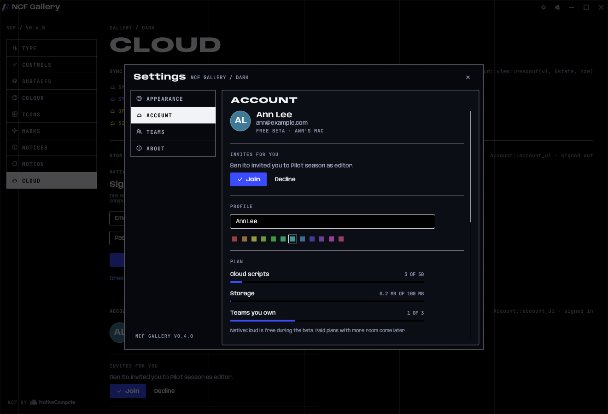

# NativeCloud in an app (`ncf::cloud`)

`ncf::cloud` connects a desktop app to NativeCloud, the account and sync service every NativeCompute app shares. It's behind the `cloud` feature and isn't part of the web build.

```toml
ncf = { git = "https://github.com/NativeCompute/ncf", tag = "v0.5.0", features = ["cloud"] }
```



The server, its API and its rules live in [NativeCompute/nativecloud](https://github.com/NativeCompute/nativecloud). This page covers the app side.

## Turning it on
Call `shell.enable_cloud(ctx, CloudConfig::nativecloud())` in your `make` closure.
- If the build has no NativeCloud address, nothing changes and the call returns `false`.
- Once it's on, Settings gains **Account** and **Teams** tabs, written by NCF:
  - sign in or create an account (confirmed with a 6-digit emailed code);
  - reset a forgotten password;
  - profile name and colour;
  - plan meters;
  - invites, computers and email and password changes;
  - sign out here or everywhere;
  - export, and account deletion;
  - teams: create, rename, invite by email, roles, remove, hand over, leave, delete.
- The address comes from `cloud::NATIVECLOUD_URL` and `cloud::NATIVECLOUD_ANON_KEY`. `NCF_CLOUD_URL` and `NCF_CLOUD_ANON_KEY` override them, for staging and tests. The anon key is public by design.

What the app reads back:

| Call | Gives |
|---|---|
| `shell.cloud_client()` | A `Client` for the signed-in account, or `None` when NativeCloud is off. Clones share one session. |
| `shell.cloud.as_mut().and_then(Account::take_changed)` | `Some(true)` after a sign-in or any team change, and `Some(false)` after sign-out. Reload your cloud lists when it fires. |
| `NcfApp::synced_settings` | The app's own settings keys that **Sync my settings** may carry between computers. Appearance keys are always included. Never list paths or anything that belongs to one computer. |

## The client
`Client` holds the session and makes typed calls that match the server's API:
- `me`, `teams`, `projects(app)`, `open_project`, `save_project`, `take_snapshot`, `changes_since`, and the rest.
- Errors are `CloudError`. Every variant has a `title()` and a `message()` written for people, so a notice can show them as they are.
- **Sessions:**
  - the refresh token is kept in the system keychain on macOS and Windows, and in a `0600` file in the app's folder on Linux;
  - an access token refreshes itself a minute before it expires, or after a `401`;
  - a revoked session turns into `CloudError::SignedOut`.
- **The server's clock:** `server_now()` follows the `date` header, so lease expiry is judged by the server's clock rather than the computer's.

## The engine
`Engine<M>` runs calls on a background thread, so the interface never waits on the network:
- `engine.run(|c| M::from(c.me()))` answers later as `Event::Reply(m)` from `engine.poll()`.
- Saves go through an outbox. `engine.save(Pending::new(project, base_version, body))` sends now, or after reconnecting.
- **The outbox:**
  - It persists on disk when it is made with `Outbox::load(path)`.
  - Several saves to one script keep the base version of the first, so only the newest text goes up.
  - Quick saves in a row rebase onto the versions this computer just made, so they never conflict with themselves.
- **When a save can't land**, nothing is lost:
  - **Someone else changed the script meanwhile:** theirs stays, yours is kept as an "offline" snapshot, and `Event::Kept { theirs, snapshot, .. }` tells the app.
  - **Someone else holds the lock:** yours becomes a snapshot, and `Event::Kept { lease, .. }` says who holds it.
- `engine.hold(project)` renews that script's lock every 30 seconds. `Event::LeaseLost { lease }` says who took it over.
- **The change feed** (with `Heartbeat::sync()`):
  - it's polled every 30 seconds, or every 5 seconds while `engine.watch(Some(project))` is set;
  - `Event::Feed(feed)` lists what moved;
  - `Event::Resync` means the app was away too long and should reload everything.
- `Event::State(SyncState)` updates the readout. `view::readout(ui, &state, now)` draws it: *SYNCED · 2S AGO*, *SYNCING · 2*, *OFFLINE · 3 WAITING*, *SIGNED OUT*.

## Testing
With the `testing` feature, `cloud::fake::FakeCloud` is an in-memory NativeCloud that follows the server's rules:
- accounts with codes;
- teams, roles and invites;
- versions, locks, snapshots, trash and the change feed;
- limits;
- account deletion.

It also has handles a test needs:
- `set_offline`;
- `advance(seconds)`, to move its clock;
- `edit_as` and `lock_as`, to act as another person;
- `code(kind, email)`, to read the emailed code;
- `fail_next`, `requests` and `count`.

`Engine::inline` runs an engine on the test's own thread, and `fake::demo(info)` builds a signed-in account with a team, people and an invite. The gallery's **Cloud** page draws from it.
