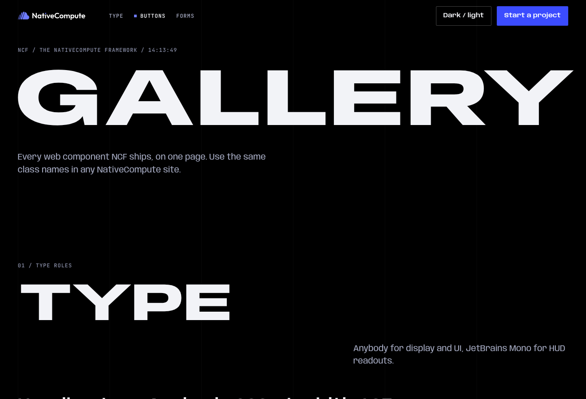
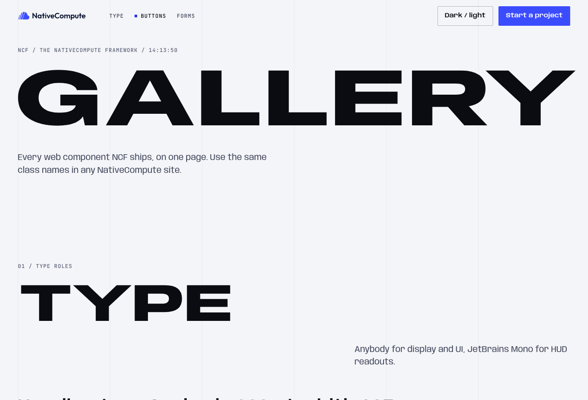
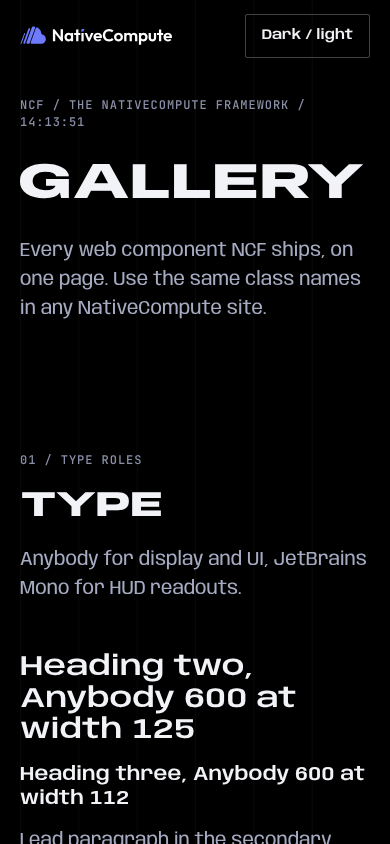
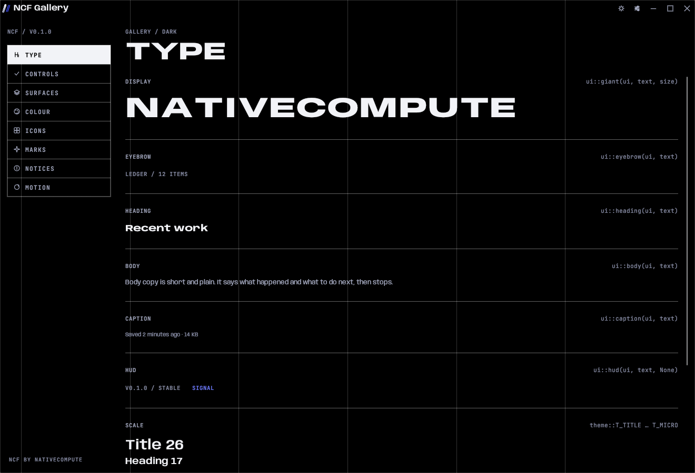
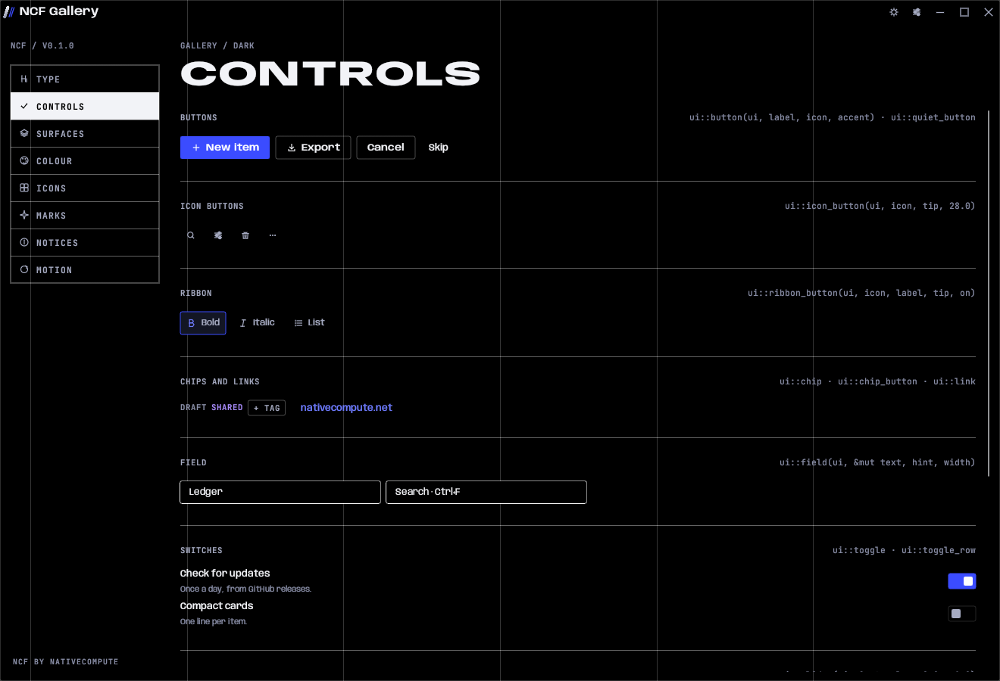
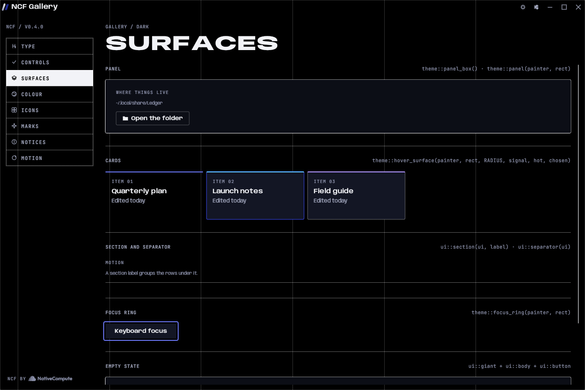
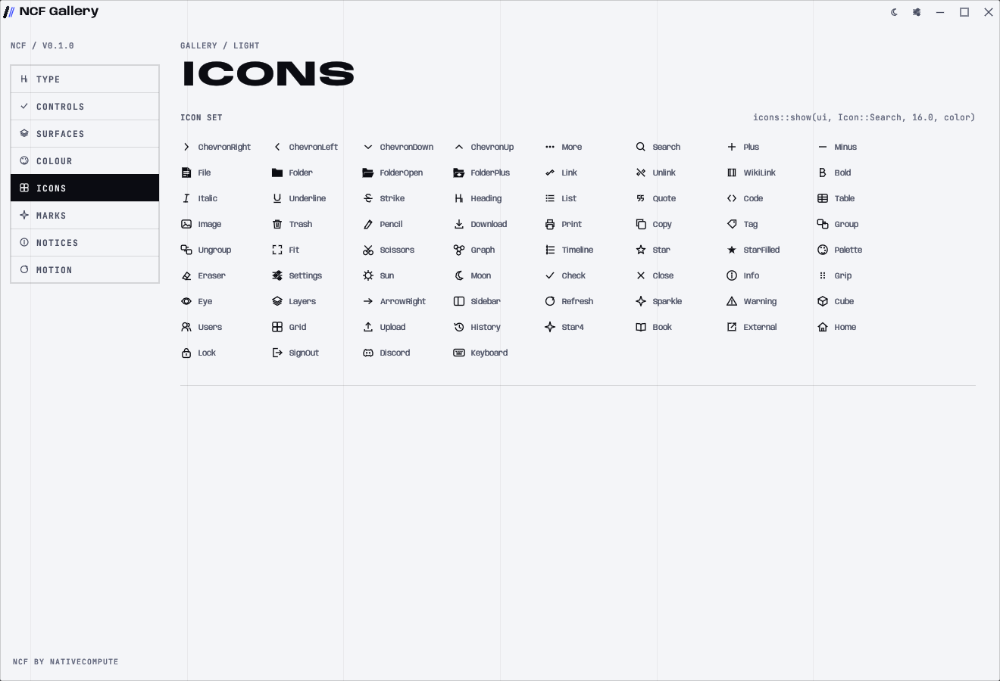
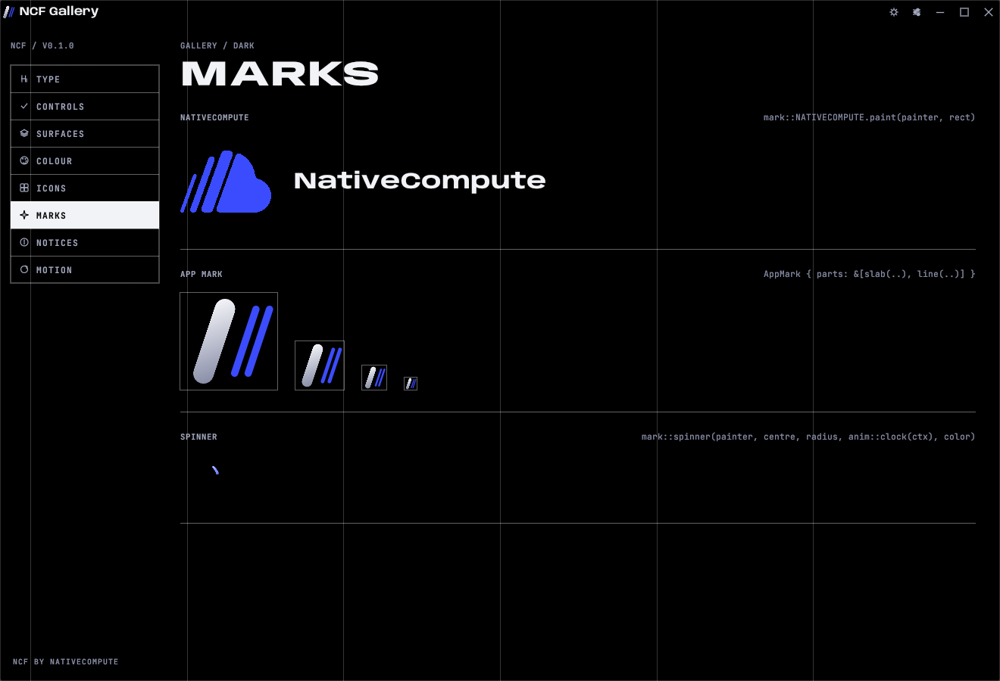

# Components

Every component NCF ships, for the desktop (`ncf` crate) and the web (`web/ncf.css` and `web/ncf.js`). Each entry gives the Rust call, the HTML, and when to use it.

The screenshots come from the desktop gallery (`cargo run -p ncf-gallery`, or `tools/shots.sh` to write them all). The web gallery is `web/gallery.html`: open it in a browser.

| Web, dark | Web, light | Web, phone |
|---|---|---|
|  |  |  |

```rust
use ncf::prelude::*;
```

brings in `ui`, `theme`, `pal`, `anim`, `Icon`, `AppInfo`, `AppMark`, `slab`, `line`, `NcfApp`, `Shell`, `Deck`, `Tone` and `egui`.

---

## Type



| Component | Rust | HTML | Use when | Don't use when |
|---|---|---|---|---|
| Giant | `ui::giant(ui, "Your items", 46.0)` | `<h1 class="giant"><span class="fit" data-fit>Gallery</span></h1>` | The page or window title. One per screen. | Anything under 26 px, or more than one per screen. |
| Giant, fitted | `ui::giant_fit(ui, name, 46.0, 28.0, width)` | `data-fit` on a `.fit` span | The title is something a person typed and could be long. | The text is fixed and known to fit. |
| Eyebrow | `ui::eyebrow(ui, "Ledger / 12 items")` | `<p class="hud">…</p>` above the title | A breadcrumb or count above a giant title. | Sentences. |
| Heading | `ui::heading(ui, "Recent work")` | `<h2 class="h2">`, `<h3 class="h3">` | A section or card title. | The screen title (use giant). |
| Body | `ui::body(ui, text)` | `<p>`, `<p class="lead">`, `<p class="sec">` | Explanations and descriptions. | Labels on controls. |
| Caption | `ui::caption(ui, text)` | `<p class="sec">` at `--t-meta` | Metadata under an item: dates, sizes, paths. | Anything a person must read to act. |
| HUD | `ui::hud(ui, "V0.1.0 / STABLE", None)` | `<span class="hud">` | Versions, counts, keyboard hints, live values. | Running text or anything over one line. |
| Link | `ui::link(ui, "nativecompute.net")` | `<a class="link">` | Leaving the app or going to another page. | Actions inside the app (use a button). |

Long text inside a fixed width goes through `ui::elide_to_width(ctx, text, font, tracking, width)`. It measures the real glyphs and cuts at a word with an ellipsis. Never cut by character count.

---

## Buttons



| Component | Rust | HTML | Use when |
|---|---|---|---|
| Primary | `ui::button(ui, "New item", Some(Icon::Plus), true)` | `<button class="btn btn--primary">` | The one action the screen exists for. |
| Ghost | `ui::button(ui, "Export", Some(Icon::Download), false)` | `<button class="btn btn--ghost">` | Every other action. |
| Quiet | `ui::quiet_button(ui, "Skip", None)` | `<button class="btn btn--quiet">` | Tertiary actions, skip, show more. |
| Danger | `shell.ask(title, body, "Delete", true, "delete")` | `<button class="btn btn--danger">` inside `.confirm` | Only as the answer to a confirmation. |
| Small | `ui::button_sized(ui, label, icon, accent, Some(w))` for a fixed width | `.btn--sm`, `.btn--block` | Toolbars, headers, a full-width footer button. |
| Icon button | `ui::icon_button(ui, Icon::Search, "Search · Ctrl+F", 28.0)` | `<button class="icon-btn" aria-label="…">` with a `.tip` | A frequent action with a well-known icon. Always give the tooltip, with the shortcut after a middle dot. |
| Ribbon button | `ui::ribbon_button(ui, Icon::Bold, "Bold", "Bold · Ctrl+B", on)` | n/a | A toggle in an editing toolbar. |

`ui::button_response` returns the `egui::Response` when you need hover or position. Buttons wipe a fill in from the left on hover and invert their label as it passes. Do not add a second hover effect.

---

## Chips

| Component | Rust | HTML | Use when |
|---|---|---|---|
| Chip | `ui::chip(ui, "Shared", Some(pal().group(2)))` | `.card-flag` | A tag on an item, in its group colour. |
| Chip button | `ui::chip_button(ui, "+ Tag")` | n/a | Adding a tag. |

A chip is never decoration on static text. If nothing can be done with it, write it as a HUD readout instead.

---

## Inputs

| Component | Rust | HTML | Use when |
|---|---|---|---|
| Field | `ui::field(ui, &mut self.name, "Name", 240.0)` | `<div class="field"><label>…</label><input class="input"><p class="hint">…</p></div>` | One line of text. Put the shortcut in the hint: `Search · Ctrl+F`. |
| Field with an error | n/a | `data-invalid="true"` on `.field`, `<p class="error">` | A web form value fails validation. Say what is wrong and how to fix it. |
| Select | `ui::dropdown` with a menu (below) | `<select class="select">` | One choice from a list. |
| Text area | `egui::TextEdit::multiline` styled by `theme::apply` | `<textarea class="textarea">` | Several lines. |
| Toggle | `ui::toggle(ui, &mut on)` | `<span class="switch"><input type="checkbox"><span></span></span>` | On or off, applied at once. |
| Toggle row | `ui::toggle_row(ui, "Compact cards", "One line per item.", &mut on)` | `<label class="check">` | A setting, with a label and one line of detail. |
| Slider | `ui::slider(ui, &mut v, 0.0..=1.0)` | `<input type="range">` (filled by `ncf.js`) | A value on a continuous scale. Show the value in the label. |
| Segmented | `ui::segmented(ui, &[("Grid", Icon::Grid), ("List", Icon::List)], i)` | `.tabs` | Two to four views of the same thing. |
| Tabs | `ui::tabs(ui, &["Dark", "Light"], i)` | `<div class="tabs" role="tablist">` with `.tab` buttons | Switching panels. On the web `ncf.js` wires arrow keys, `aria-selected` and `hidden`. |
| Vertical tabs | `ui::vertical_tabs(ui, &[("Appearance", Icon::Palette), …], i)` | n/a | The left rail of a settings window or a gallery. |
| Swatch | `ui::swatch(ui, colour, "Blue", selected, None)` | n/a | Picking a group colour. |

---

## Menus and popovers

```rust
let resp = ui::dropdown(ui, Icon::List, &self.sort, self.open, 200.0);
if resp.clicked() {
    self.open = !self.open;
    self.opened_on = shell.frame_no;
}
if self.open {
    let mut rects = vec![resp.rect];
    egui::Area::new(egui::Id::new("sort-menu"))
        .order(egui::Order::Foreground)
        .fixed_pos(resp.rect.left_bottom() + egui::vec2(0.0, 4.0))
        .show(ui.ctx(), |ui| {
            ui::popover_frame().show(ui, |ui| {
                ui.set_width(192.0);
                if ui::menu_item(ui, &mut rects, "Newest first", Icon::History, false) { … }
                if ui::menu_item(ui, &mut rects, "Clear all", Icon::Trash, true) { … }
            });
        });
    if (ui::Dismisser { opened_on: self.opened_on }).should_close(ui.ctx(), shell.frame_no, &rects) {
        self.open = false;
    }
}
```

- `ui::menu_width(ui, &labels)` sizes a menu to its longest label.
- `ui::menu_item_enabled` greys out an item that cannot run now. Keep it visible so people learn it exists.
- A critical item (`true`) turns red on hover. Put it last, after a gap.

---

## Surfaces



| Component | Rust | HTML | Use when |
|---|---|---|---|
| Panel | `theme::panel_box().show(ui, \|ui\| …)` or `theme::panel(painter, rect)` | `<div class="panel panel-pad">` | Grouping related content. |
| Bracketed panel | n/a | `.panel.bracket` | A featured panel on a marketing page. |
| Card | `theme::hover_surface(painter, rect, theme::RADIUS, p.signal, hot, chosen)` | `<article class="card">`, `.card--chosen` | An item in a grid a person can open. |
| Section label | `ui::section(ui, "Where things live")` | `<p class="hud">01 / Section</p>` in `.section-head` | Grouping rows in settings or a long page. |
| Separator | `ui::separator(ui)` | `<hr>` or a hairline border | Between groups of rows. |
| Spec list | n/a | `<dl class="spec">`, `<dl class="facts">` | Pairs of label and value. |
| FAQ | n/a | `<div class="faq"><details>…</details></div>` | Questions and answers. |
| Focus ring | `theme::focus_ring(painter, rect)` | automatic on `:focus-visible` | Any control you draw yourself that takes keyboard focus. |
| Scrim | `ui::scrim(ctx, id, t)` | `.tray-scrim` | Behind a modal window. |

---

## Notices and confirmation

Notices stack at the bottom centre, with fully rounded ends and a faint wash of their tone colour that fades from the top, and leave on their own. Confirmations sit in the centre over a scrim, with the same wash, and wait for an answer.

| Component | Rust | Web | Use when |
|---|---|---|---|
| Info | `shell.say(title, body)` | `NCF.toast("Saved.")` | Something happened that a person might want to know. |
| Done | `shell.ok(title, body)` | `NCF.toast("Exported.", { label: "Open", run })` | An action finished. Offer the next step if there is one. |
| Warning | `shell.warn(title, body)` | `NCF.toast(…)` | Something failed. Say what and what to do. |
| Confirm | `shell.ask(title, body, yes, danger, action)`, then handle `action` in `NcfApp::answer` | `await NCF.confirm({ title, body, yes, danger })` | Before anything that cannot be undone. |
| Tray | n/a | `<div class="tray-root" data-tray>`, opened by `data-tray-open="id"` or `NCF.tray.open(id)` | A slide-over panel for detail or a form on the web. |
| Banner | n/a | `<div class="banner">` | One persistent line at the top of a form. |

Outside `ncf::app`, an app can own a `Deck<A>` directly and call `deck.show(ctx)` each frame.

---

## Window chrome

Supplied by `ncf::app::run`. You do not call these unless you build your own shell.

| Part | Rust |
|---|---|
| Backdrop and column guides | `chrome::backdrop(ctx, pal().void)`, `chrome::column_guides(painter, rect)` |
| Title bar with the app mark, name, extras and window buttons | `chrome::title_bar(ui, ctx, &info, \|ui\| …)` |
| Resize grips for the undecorated window | `chrome::resize_handles(ctx)` |
| Splash card | `splash::Splash::new(info).show(ctx)` |
| Maker line ("Ledger by NativeCompute", links to nativecompute.net) | `ui::maker_line(ui, rect, centred, "Ledger")` |

On the web the same jobs are done by `.site-header` (`data-header` hides it on scroll down), `.nav`, `.mobile-nav`, `.site-footer` and `.maker`.

---

## Icons



`ncf::icons::show(ui, Icon::Search, 16.0, pal().text)` places an icon. `icons::draw(painter, rect, icon, colour)` paints one into a rect. `Icon::ALL` lists every icon. The gallery's Icons page shows them with their names.

Missing an icon? Add it to `crates/ncf/src/icons.rs` as strokes on the same 1.5 px weight, add it to `Icon::ALL`, and run the gallery in both casts at 13 and 16 px.

On the web, icons are inline SVG with `stroke="currentColor"` and `stroke-width="1.6"` on a 20 px box.

---

## Marks



- `mark::NATIVECOMPUTE.paint(painter, rect)` is the company mark. On the web use `brand/mark.svg`, `brand/logo-dark.svg` (on dark) and `brand/logo.svg` (on light) with the `.on-dark` and `.on-light` classes.
- Each app has its own mark built from slanted strokes. See [`brand.md`](brand.md#app-marks).
- `mark::spinner(painter, centre, radius, anim::clock(ctx), pal().signal_hi)` is the one loading indicator. Call `anim::keep_going(ctx)` while it shows.

---

## Keyboard

```rust
#[derive(Clone, Copy, PartialEq, Eq, Debug)]
enum Cmd { NewItem, Search }

impl ncf::keys::Command for Cmd { … }

let mut keymap: Keymap<Cmd> = Keymap::default();
for cmd in keys::fired(ctx, &keymap, &Cmd::all(), ncf::WEB) { … }
```

- `keys::settings_ui(ui, &mut keymap, &mut capture, &Cmd::all(), ncf::WEB)` is the whole Settings → Keyboard page: every command, its keys, rebinding and reset.
- `keys::keycap(ui, label, listening, custom)` draws one key: a 6 px rounded cap in mono type, tinted signal while it listens and when the binding is custom.
- Write bindings with `keymap.serialize()` from `NcfApp::write_settings` and read them back with `keymap.parse_line(key, value)` in `read_setting`.
- Shortcut text in tooltips and hints comes from `keymap.label(cmd, ncf::WEB)` or `keys::text(&shortcut)`, after a middle dot: `Search · Ctrl+F`.

---

## Web behaviour (`ncf.js`)

| Hook | Does |
|---|---|
| `data-header` | Gives the header its fill and hairline once the page scrolls. Wires the mobile menu button (`data-menu`). |
| `role="tablist"` | Arrow keys, Home and End, `aria-selected`, `hidden` panels, optional `#hash` sync (`data-hash="off"` to disable). |
| `data-fit` | Fits giant text to its container on load and resize. |
| `data-clock` | A live HH:MM:SS clock. |
| `data-copy="#selector"` or `data-copy-text="…"` | Copies the element's text, or the given text, and confirms with a toast (`data-copied` changes the message). |
| `data-tray`, `data-tray-open`, `data-tray-close` | The slide-over tray, with focus trap and Escape. |
| `data-theme-toggle` | Switches dark and light and remembers it. |
| `input[type=range]` | Paints the filled part of the track. |

`window.NCF` gives `toast(text, action?)`, `confirm({ title, body, yes, no, danger })` (resolves to true or false), `tray.open(id)` and `tray.close(id)`, `setTheme("dark" | "light")`, `fit()` and `reduceMotion`.
