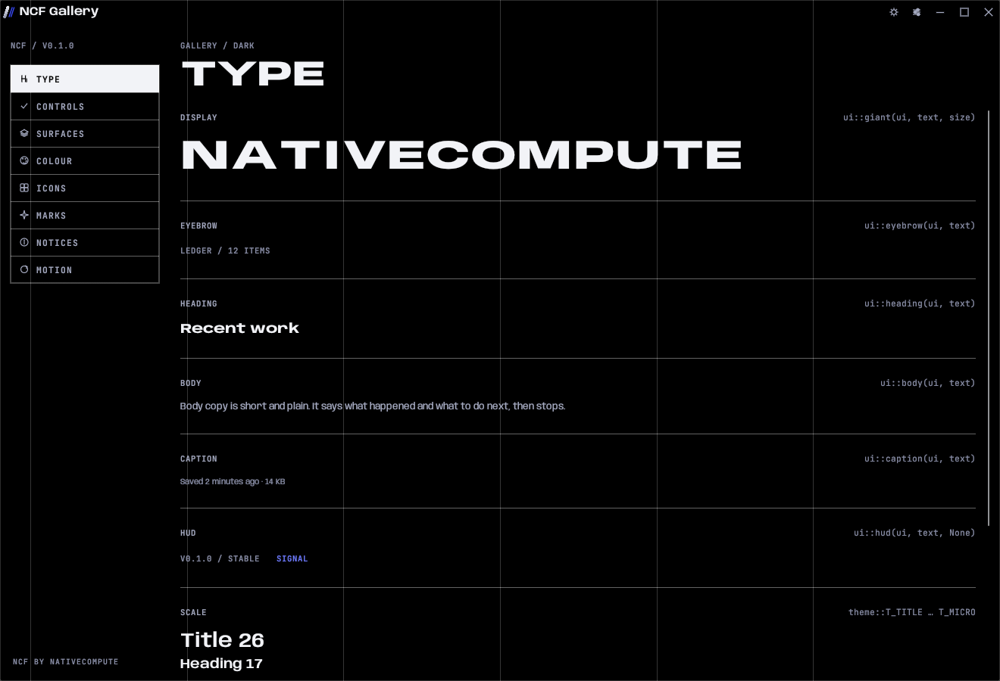
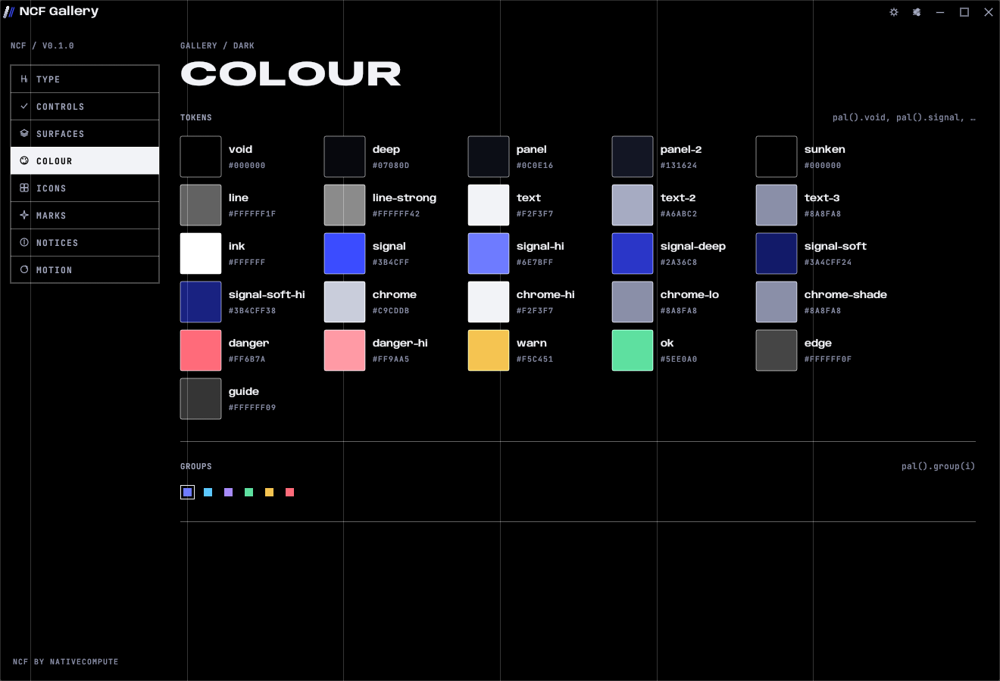
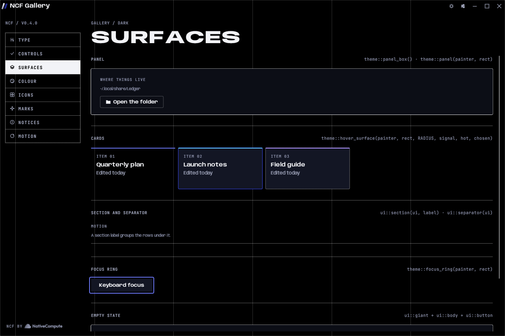
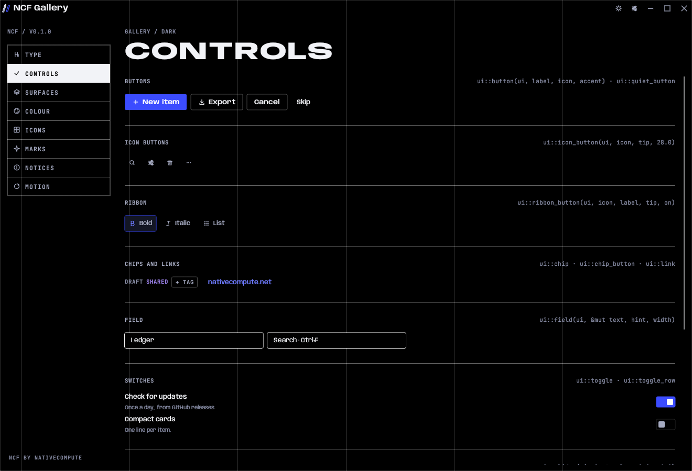
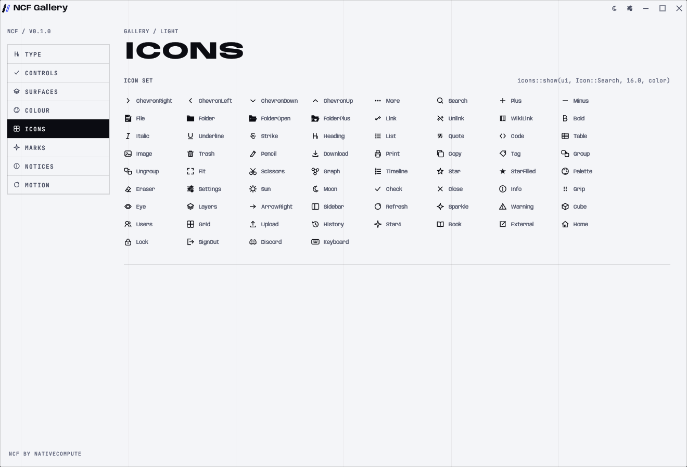
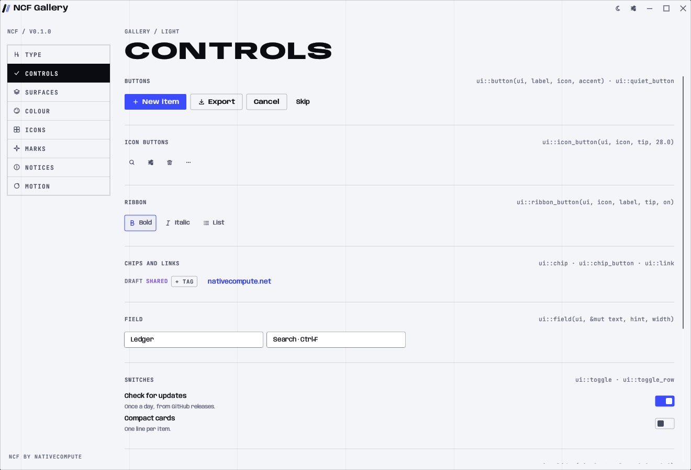

# Design language

NativeCompute looks like an instrument panel at night: black, hairlines, one blue signal, and big confident type. Everything on screen is there to be read or used. Nothing is there for decoration.

The values on this page come from [`tokens/ncf.toml`](../tokens/ncf.toml). If this page and the file ever disagree, the file is right.

## Principles

1. **Black first.** The dark cast is the brand. `void` (#000000) sits behind everything. The light cast is the same language on paper white, for people who need it.
2. **One signal.** Signal blue (#3B4CFF) marks what matters most on a screen: the primary action, the selected item, the live value. If two things are blue, one of them is wrong.
3. **Hairlines, not shadows.** Surfaces are separated by 1 px lines at low alpha and by small steps in fill. There is no elevation.
4. **Big type, small chrome.** Page titles are huge and set in the display face. Controls stay small and quiet so the content and the title carry the screen.
5. **Readouts, not decoration.** Status, versions, counts and paths are set like instrument readouts in upper-case mono (the HUD role). They replace badges, pills and icons-as-ornament.
6. **The grid shows.** Six faint column guides run behind the content. They are part of the identity, not a debug overlay.
7. **Motion confirms, never performs.** Hover and press respond in 100 to 240 ms with a sharp ease-out. Nothing bounces while a person waits.

## Colour

Two casts, dark and light, share the same names. Code asks for `pal().panel`, never for a hex value, so every screen works in both.

| Role | Tokens | Use |
|---|---|---|
| Surfaces | `void`, `deep`, `panel`, `panel-2`, `sunken` | Window background, then raised layers in order. `sunken` is for wells such as fields. |
| Lines | `line`, `line-strong` | Hairline borders. `line-strong` for controls and panels a person can act on. |
| Text | `text`, `text-2`, `text-3` | Primary, secondary and tertiary. All three meet AA on every surface. |
| Signal | `signal`, `signal-hi`, `signal-deep`, `signal-soft`, `signal-soft-hi` | The one accent. `signal` for fills, `signal-hi` for text, rings and links, `signal-soft` for washes behind a selected item. |
| Ink | `ink` | Text on a signal fill. Always white. |
| Chrome | `chrome`, `chrome-hi`, `chrome-lo` | The neutral metal of app marks and the title-bar wordmark. |
| Status | `ok`, `warn`, `danger`, `danger-hi` | Results and warnings only, never decoration. |
| Structure | `edge`, `guide` | The inset top edge on panels and the column guides. |
| Groups | `groups[0..6]` | Six hues for things a person colours themselves (tags, groups, series). Never for chrome. |

`cargo test -p ncf-tokens` checks that `text`, `text-2`, `text-3` and `signal-hi` reach 4.5:1 on every surface in both casts, and that `ink` does on `signal`.

## Type

Two families, five roles. Both families ship with NCF (`crates/ncf/fonts`, `web/fonts`) under the SIL Open Font License.

| Role | Face | Desktop | Web | Use |
|---|---|---|---|---|
| Display | Anybody 800, width 150, upper case, tracking -0.02em | `ui::giant`, `theme::font_display` | `.giant` | Page titles and giant words. 26 px and up. |
| Heading | Anybody 700, width 130 | `ui::heading`, `theme::font_bold` | `.h2`, `.h3` | Section and card titles. |
| UI | Anybody 600, width 112 | `theme::font_semi`, buttons, labels | `.btn`, labels | Controls and short labels. |
| Body | Anybody 400 | `ui::body`, `theme::font` | `p`, `.lead`, `.sec` | Running text. |
| HUD | JetBrains Mono 500, upper case, tracking 0.08em | `ui::hud`, `ui::eyebrow`, `theme::font_hud` | `.hud` | Readouts: versions, counts, paths, breadcrumbs, keyboard hints. |

Desktop sizes (`theme::T_*`): title 26, heading 17, body 14.5, small 13, label 12, caption 11, micro 10. Web sizes are a 1.2 ratio scale from `--t-meta` (0.75rem) to `--t-5` (2.488rem), and giant type is fitted to its container with `data-fit`.

Rules:
- Sentence case everywhere except display and HUD.
- No text below 10 px on desktop or 12 px on the web.
- Body line height 1.5 to 1.6 on the web.

## Space and shape

- Spacing steps of 4 and 8: `SPACE_1` 4, `SPACE_2` 8, `SPACE_3` 12, `SPACE_4` 16, `SPACE_6` 24, `SPACE_8` 32, then 48, 64, 96, 128.
- Corner radius is 2 px (`RADIUS`, `--r-sm`). Two things NCF draws are deliberately softer: notices have fully rounded ends so they read as passing messages, and keycaps are rounded at 6 px so they read as keys.
- Lines are 1 px. Focus rings are 2 px `signal-hi` with a 2 px offset.
- Six columns with a 40 px gutter (20 px on narrow screens). The guides are drawn by `chrome::column_guides` and by `body::before` on the web.

## Surfaces

- **Window:** `void`, with the column guides.
- **Panel:** `panel` fill, `line-strong` hairline, and on dark the faint inset `edge` along the top. `theme::panel_box()` or `theme::panel(painter, rect)`; `.panel` on the web.
- **Card:** clear until hovered, then `panel-2` with a `line-strong` edge. A chosen card keeps the fill and takes a `signal` edge. `theme::hover_surface`; `.card` and `.card--chosen` on the web.
- **Popover and menu:** `panel` with `line-strong`, 4 px inset. `ui::popover_frame()`.
- **Scrim:** behind modal windows, black at 70%. `ui::scrim`.

## Buttons

- **Primary:** signal fill, white text. One per screen, for the action the screen exists for. `ui::button(ui, label, icon, true)`; `.btn--primary`.
- **Ghost:** clear with a `line-strong` hairline. Every other action. `ui::button(ui, label, icon, false)`; `.btn--ghost`.
- **Quiet:** text only, for skip, cancel-like and tertiary actions. `ui::quiet_button`; `.btn--quiet`.
- **Confirmation answers:** the answer buttons in a confirmation are their own small family. The main answer is filled with the tone colour (signal, or danger for a destructive answer) and shaded slightly darker toward the bottom; it brightens on hover. Cancel is a faint text wash. `shell.ask(..)`; `.btn--danger` on the web.
- On hover a text-coloured fill wipes in from the left over `MOTION_SLOW` (300 ms) and the label inverts as the edge passes. It does not glow or lift.

## Icons

Icons are drawn in code from strokes and simple shapes (`ncf::icons`), at 13 to 16 px, in the colour of the text beside them. Use them to help a person find an action, not to decorate a heading.

## Light cast

The light cast swaps every token for its paper equivalent. `signal-hi` gets darker instead of lighter so it still reads on white, `edge` disappears, and the guides darken slightly. Never special-case the light cast in an app: if something looks wrong in light, the token is wrong, and the fix goes into `tokens/ncf.toml`.

