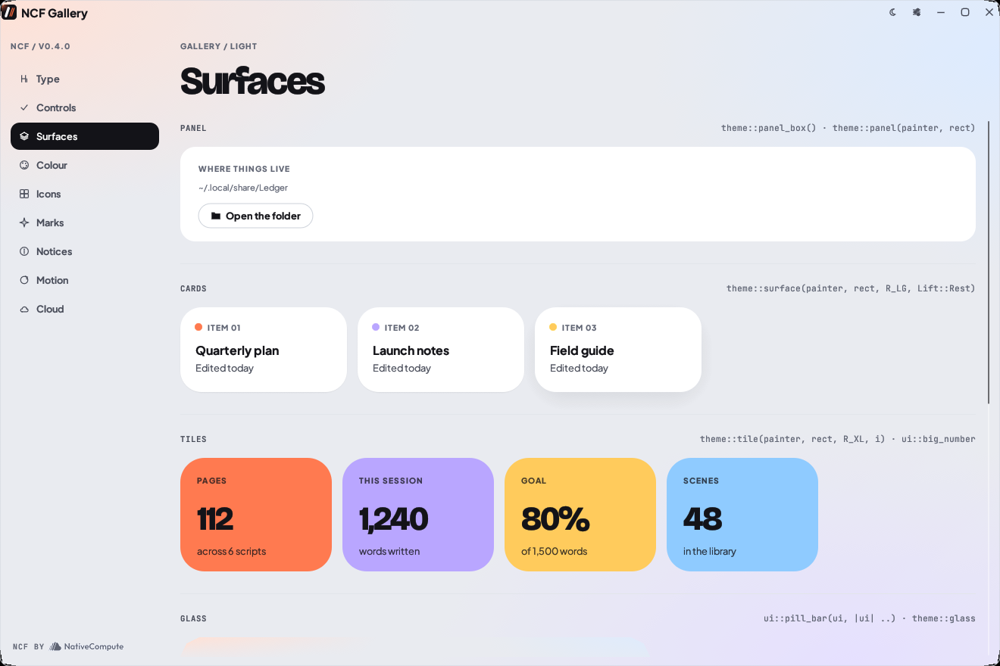
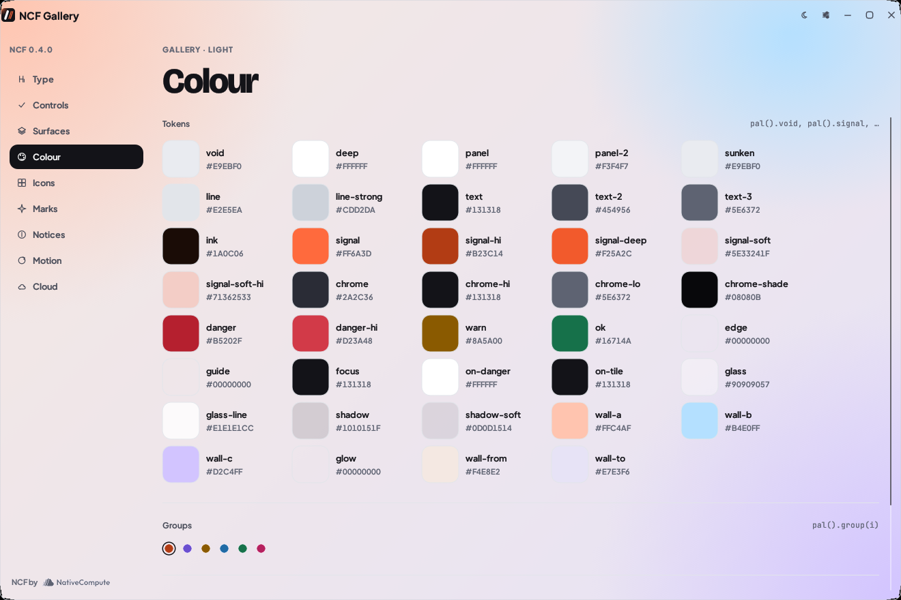
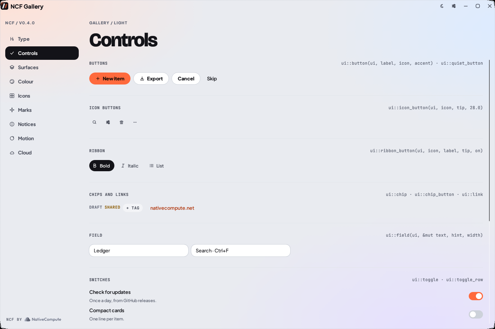
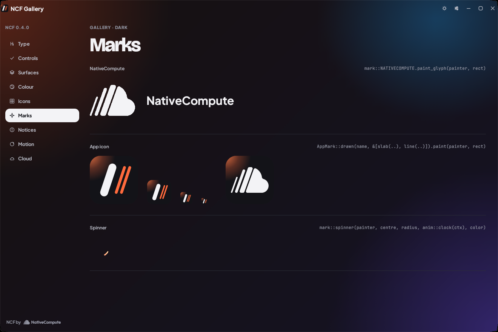
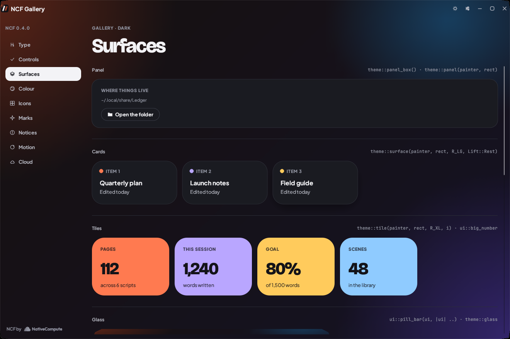

# Design language

NativeCompute is Bento: rounded tiles on a soft wallpaper, one coral accent, a few bright colour tiles for the things that matter, and big, friendly type. Everything on screen is there to be read or used. Nothing is there for decoration.

The values on this page come from [`tokens/ncf.toml`](../tokens/ncf.toml). If this page and the file ever disagree, the file is right.

## Principles

1. **Tiles, not lines.** Content sits on rounded surfaces with soft shadows over the wallpaper. Hairlines are for the dark cast and for dividers inside a surface.
2. **One accent.** Coral (`signal`, #FF6A3D) marks the primary action, progress and the caret. If two things on a screen are coral, one of them is wrong.
3. **Colour tiles carry the numbers.** Coral, lilac, sun and sky tiles hold the few facts a screen exists to show (a count, a goal, the thing to continue). Their text is always ink.
4. **Big type, small chrome.** Page titles and numbers are set large in Bricolage Grotesque. Controls stay small and quiet.
5. **Floating chrome.** Toolbars and menus float as frosted pills above the content.
6. **Follow the computer.** Light and dark are the same language. The app follows the system unless a person picks one.
7. **Motion confirms, never performs.** Hover and press respond in 100 to 240 ms with a sharp ease-out. Nothing bounces while a person waits.

## Colour

Two casts, light and dark, share the same names. Code asks for `pal().panel`, never for a hex value, so every screen works in both.

| Role | Tokens | Use |
|---|---|---|
| Ground | `void`, `sunken`, `wall-a/b/c`, `glow` | The wallpaper behind everything: `void` with three soft corner washes, plus the coral `glow` in the dark cast. |
| Surfaces | `deep`, `panel`, `panel-2` | White (light) or graphite (dark) surfaces; `panel-2` for wells, chips and hover. |
| Lines | `line`, `line-strong` | Dividers inside surfaces, field edges, and the edge of surfaces in the dark cast. |
| Text | `text`, `text-2`, `text-3` | Primary, secondary and tertiary. All three meet AA on every surface. |
| Accent | `signal`, `signal-deep`, `signal-hi`, `signal-soft`, `signal-soft-hi` | `signal` fills, `signal-deep` on hover, `signal-hi` for accent text and links, the soft ones for washes. |
| On fills | `ink`, `on-tile`, `on-danger`, `focus` | Text on coral, text on tiles, text on danger, and the focus ring. |
| Tiles | `brights[0..6]` | Coral, lilac, sun, sky, mint, rose. The same in both casts. `pal().tile(i)` uses the first four. |
| Glass and shadow | `glass`, `glass-line`, `shadow`, `shadow-soft` | Frosted floating chrome and the colour of the token shadows. |
| Status | `ok`, `warn`, `danger`, `danger-hi` | Results and warnings only, never decoration. |
| Groups | `groups[0..6]` | Text-safe versions of the tile hues for things a person colours themselves (storylines, tags, characters). |

`cargo test -p ncf-tokens` checks every text pair on every surface, text on glass and on the wallpaper, ink on coral, on-tile on every tile and the groups on surfaces, in both casts.

## Type

Three families, five roles. All ship with NCF (`crates/ncf/fonts`, `web/fonts`) under the SIL Open Font License.

| Role | Face | Desktop | Web | Use |
|---|---|---|---|---|
| Display | Bricolage Grotesque 800, sentence case, tracking -0.045em | `ui::giant`, `ui::big_number`, `theme::font_display` | `.giant`, `.num` | Page titles, giant words and big numbers. 26 px and up. |
| Heading | Bricolage Grotesque 800 (text cut), tracking -0.02em | `ui::heading`, `theme::font_heading` | `.h2`, `.h3` | Section and card titles. |
| UI | Plus Jakarta Sans 600 and 700 | `theme::font_semi`, `theme::font_bold`, buttons, labels | `.btn`, labels | Controls and short labels. |
| Body | Plus Jakarta Sans 400 | `ui::body`, `theme::font` | `p`, `.lead`, `.sec` | Running text. |
| Label | Plus Jakarta Sans 560 (the label cut), tabular figures, sentence case | `ui::hud`, `theme::font_hud` | `.hud` | Labels and readouts: counts, versions, paths, live values. Figures line up in columns. |
| Mono | JetBrains Mono 500 | `theme::font_mono`, `keys::keycap` | `code`, `.kbd` | Keycaps and code only. |

Eyebrows (`ui::eyebrow`) are Plus Jakarta Sans 700 in upper case at 0.06em, in `text-3`. They are the only capitals in the interface: *Continue writing*, *Next deadline*, and the group headings `ui::section` draws.

Desktop sizes (`theme::T_*`): title 26, heading 17, body 14.5, small 13, label 12, caption 11, micro 10. Web sizes are a 1.2 ratio scale from `--t-meta` (0.75rem) to `--t-5` (2.488rem), and giant type is fitted to its container with `data-fit`.

## Space and shape

- Spacing steps of 4 and 8: `SPACE_1` 4, `SPACE_2` 8, `SPACE_3` 12, `SPACE_4` 16, `SPACE_6` 24, `SPACE_8` 32, then 48, 64, 96, 128.
- Radius scale: `R_SM` 12, `R_MD` 20, `R_LG` 28, `R_XL` 32 and `R_PILL`. On the web: `--r-sm`, `--r`, `--r-lg`, `--r-xl`, `--r-pill`.
- Shadows: `Lift::Rest` (0 1 2) under small things, `Lift::Float` (0 10 30) under floating chrome and popovers, `Lift::Lift` (0 16 40) under windows and lifted cards.
- Focus rings are 2 px `focus` with a 2 px offset, following the element's corners.

## Surfaces

- **Window:** the wallpaper (`chrome::backdrop`).
- **Surface:** `theme::surface(painter, rect, radius, lift)` or `theme::surface_frame`. White in light with no edge; graphite with a `line` edge in dark. `.panel` and `.card` on the web.
- **Tile:** `theme::tile(painter, rect, R_XL, i)` with `on_tile` text and `ui::big_number`. `.tile--coral` and friends on the web.
- **Glass:** `ui::pill_bar` and `theme::glass` for floating bars; the web header uses real blur.
- **Popover and menu:** `ui::popover_frame()`: a surface at about 16 px corners with a float shadow.
- **Scrim:** behind modal windows, `pal().scrim()`. `ui::scrim`.

## Buttons

- **Primary:** coral pill with ink text; darkens to `signal-deep` on hover. One per screen. `ui::button(ui, label, icon, true)`; `.btn--primary`.
- **Ghost:** surface pill with a `line-strong` edge. Every other action. `ui::button(ui, label, icon, false)`; `.btn--ghost`.
- **Quiet:** text only, with a `panel-2` pill on hover. `ui::quiet_button`; `.btn--quiet`.
- **Danger:** `danger` pill with `on_danger` text, in confirmations only.

## Icons and marks

Icons are drawn in code from strokes and simple shapes (`ncf::icons`), at 13 to 16 px, in the colour of the text beside them.

App icons sit on the Bento tile: ink with a coral glow in the top-left corner. See [`brand.md`](brand.md).

## The dark cast

The dark cast swaps every token for its night equivalent: graphite surfaces with hairline edges, `signal-hi` lighter so it reads on dark, and the coral corner glow on the wallpaper. Tiles stay bright. Never special-case a cast in an app: if something looks wrong in one cast, the token is wrong, and the fix goes into `tokens/ncf.toml`.

