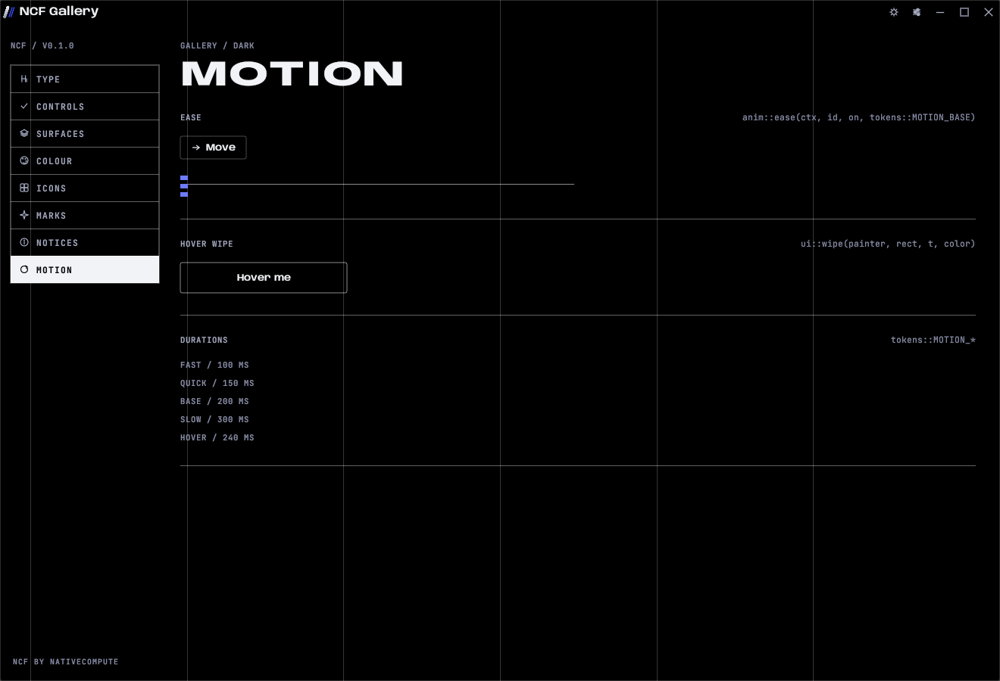

# Motion

Motion in NativeCompute apps confirms that something happened. It is quick, it starts fast and settles, and it never makes a person wait.



## Durations

| Token | Rust | CSS | Use |
|---|---|---|---|
| fast, 100 ms | `tokens::MOTION_FAST` | `--m-100` | Colour changes on small controls, press states. |
| quick, 150 ms | `tokens::MOTION_QUICK` | `--m-150` | Tabs and segments changing, toasts leaving, borders on hover. |
| base, 200 ms | `tokens::MOTION_BASE` | `--m-200` | Tooltips, menus opening, toasts arriving. |
| slow, 300 ms | `tokens::MOTION_SLOW` | `--m-300` | Windows and trays opening, the button wipe, page transitions. |
| hover, 240 ms | `tokens::MOTION_HOVER`, `anim::HOVER` | n/a | Hover fills on cards, menu items, dropdowns and icon buttons. |

Nothing runs longer than 300 ms, except:
- the splash: it holds for 1.55 s, then fades over 0.4 s; a click skips it;
- notices and confirmations arriving, 420 ms;
- a page-load reveal on the web, up to 600 ms;
- continuous indicators (the spinner) while work is running.

## Easing

- **Ease-out** for everything that arrives: `cubic-bezier(0.16, 1, 0.3, 1)` (`--ease-out`, `tokens::EASE_OUT`). Fast start, long settle.
- **Ease-in** for things that leave: `cubic-bezier(0.7, 0, 0.84, 0)` (`--ease-in`, `tokens::EASE_IN`).
- In egui, `anim::ease` gives a smootherstep curve for on/off states, and `anim::glide` gives an exponential ease-out for moving to a new value. `ui::wipe` applies the exponential ease-out itself.

## The drivers

```rust
let hot = anim::ease(ui.ctx(), resp.id, resp.hovered(), anim::HOVER);
let open = anim::ease(ctx, "sort-menu", self.open, tokens::MOTION_BASE);
let x = anim::glide(ctx, "rail-x", target_x, tokens::MOTION_SLOW);
let v = anim::to(ctx, "level", self.level, tokens::MOTION_QUICK);
```

| Function | Gives | Use |
|---|---|---|
| `anim::ease(ctx, id, on, secs)` | 0 to 1, eased | Hover, open and closed, selected. |
| `anim::to(ctx, id, target, secs)` | Linear approach to a value | Numbers that change often, such as a slider fill. |
| `anim::glide(ctx, id, target, secs)` | Ease-out approach to a value | Positions: a moving indicator, a panel sliding in. |
| `anim::clock(ctx)` | Seconds since start | Continuous indicators. |
| `anim::breathe(ctx, period)` | 0 to 1 and back | A live dot or a waiting state. Sparingly. |
| `anim::keep_going(ctx)` | Asks for the next frame | Call while something continuous is on screen. |

`anim::pop` and `anim::ease_out_back` give notices and confirmations their small overshoot, and that is where they belong. `anim::spring_to`, `anim::bounce_in` and `anim::ease_out_elastic` exist for Blackline's existing flourishes. Do not use any of them for new screens, lists or anything a person waits on.

## What moves

| Event | Motion |
|---|---|
| Hover on a button | A fill wipes in from the left (300 ms, ease-out) and the label inverts as the edge passes. |
| Hover on a card or menu item | Fill and hairline fade in (240 ms). Menu items also show a 2 px signal bar on the left. |
| Tab or segment change | The selected fill fades across (150 ms). |
| Settings window | The scrim fades in and the window grows from 97% to 100% while it fades in (300 ms). |
| Notice | Rises from the bottom edge with a small overshoot (`anim::pop`, 420 ms), stacks upward, leaves on its own after a few seconds and sinks away in 220 ms. |
| Confirmation | Grows from 90% to 100% at the centre with a slight overshoot (`anim::ease_out_back`, 420 ms) over a scrim. |
| Splash | The name drifts 10 px into place over 550 ms, the progress line fills, then the card fades. |
| Web header | Clear at the top of the page; takes the `void` fill and a hairline once the page scrolls (150 ms). |
| Web tooltip | Fades and rises 4 px (200 ms). |
| Web page change | A 300 ms cross-fade view transition. |

Only transform and opacity animate on the web. Never animate layout, colour on large areas, or blur.

## Turning it off

- The desktop Settings → Appearance → Animations switch calls `anim::set_enabled(false)`. Every driver above then returns its end value at once, and the splash is skipped. Code that animates by hand must check `anim::enabled()`.
- On the web, `prefers-reduced-motion: reduce` turns transitions and view transitions off in `ncf.css`, and `NCF.reduceMotion` tells your scripts.
